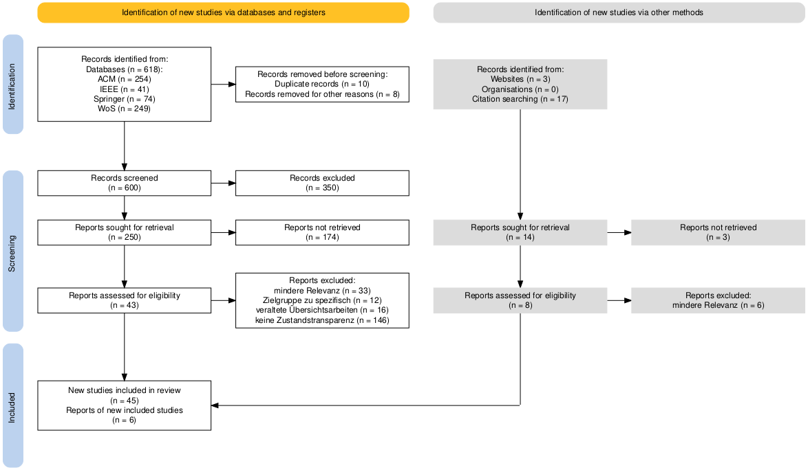

# Literaturanalyse

## Vorgehen

Die Literaturanalyse bildet die praktische Umsetzung des im [methodischen
Rahmen](method) beschriebenen Forschungsdesigns. Die Recherche deckte vier
Konzeptbereiche ab: *Conversational Systems*, *State Concepts*,
*Transition Concepts* und *Transparency Concepts*. Aufgrund der uneinheitlichen
Begriffsverwendung wurde die Suche auf fünf Suchstrings verteilt. So sollte
vermieden werden, dass ein zu breiter Suchstring unpassende Treffer liefert
oder ein zu enger Suchstring relevante Arbeiten ausschließt.

## Suchstrategie

	

		

			

				<h3>Suchstring A</h3>
			

			

				
("conversational agent" OR "conversational user interface" OR "conversational AI") AND ("interaction state" OR "dialogue state" OR "process state" OR "state transition" OR "mode switching")

			

		

	

	

		

			

				<h3>Suchstring B</h3>
			

			

				
("conversational agent" OR "conversational user interface" OR "conversational AI") AND (interaction OR dialogue OR conversation) AND ("transparency cue" OR transparency OR visibility OR "mental model")

			

		

	

	

		

			

				<h3>Suchstring AB kombiniert</h3>
			

			

				
("conversational agent" OR "conversational user interface" OR "conversational AI") AND ("interaction state" OR "dialogue state" OR "process state" OR "state transition") AND ("mode switching" OR "context switch" OR "mixed-initiative interaction") AND ("transparency cue" OR transparency OR visibility)

			

		

	

	

		

			

				<h3>Suchstring C</h3>
			

			

				
("conversational agent" OR "conversational AI" OR chatbot OR "dialogue system" OR "LLM agent") AND ("state transparency" OR "system status" OR "status indicator" OR "process transparency" OR "state disclosure" OR "visibility of system status") AND (taxonomy OR framework OR typology OR dimensions OR classification OR "systematic review")

			

		

	

	

		

			

				<h3>Suchstring D</h3>
			

			

				
("conversational agent" OR "conversational AI" OR chatbot OR "dialogue system" OR "voice assistant") AND ("chain-of-thought" OR "reasoning trace" OR "thinking indicator" OR "tool use" OR "tool calling" OR "function calling" OR "typing indicator" OR "progress indicator") AND ("user-facing" OR "human-AI interaction" OR "user trust" OR "user understanding" OR "user experience" OR explainability OR "system status") NOT (("prompt engineering") AND (accuracy OR benchmark OR "few-shot"))

			

		

	

## Screening und Dokumentation

Das Screening wurde zweistufig nach PRISMA durchgeführt: zunächst anhand von
Titel und Abstract, anschließend im Volltext. Eingeschlossen wurde peer-reviewte
Primärliteratur der letzten fünf Jahre, die Interaktionszustände,
Zustandsübergänge oder Mechanismen der Zustandstransparenz in
Conversational-AI-Systemen und Sprachagenten untersucht. Rein technische
Beiträge ohne Fokus auf die Nutzerinteraktion wurden ausgeschlossen. Der
Such- und Screeningprozess ergab einen Korpus von 51 Publikationen.

Jeder Datensatz und die daraus hervorgehenden Erkenntnisse wurden in einer
strukturierten Tabelle dokumentiert. Erfasst wurden:

| Feld | Inhalt |
| --- | --- |
| Referenz | Autorinnen und Autoren sowie Erscheinungsjahr |
| Titel | Titel der Publikation |
| Interaktionszustand | Untersuchter Zustand oder Zustandsübergang |
| Merkmale | Identifizierte Eigenschaften des Zustandsübergangs |
| Implikationen für HCI und Design | Folgerungen für Gestaltung und Interaktion |
| Domäne | Anwendungskontext der Untersuchung |
| Relevanz | Beitrag zur Beantwortung der Forschungsfragen |
| Modalität(en) | Eingesetzte Interaktionsmodalitäten |
| Publikationsart | Typ der Publikation |

Die Tabelle diente nicht nur der Dokumentation einzelner Treffer, sondern auch
der fortlaufenden Sicherung und Vergleichbarkeit neu entstehender Einsichten.

## Kodierung und Synthese

Die eingeschlossenen Arbeiten wurden induktiv codiert und in einer
Konzeptmatrix nach Webster und Watson (2002) erfasst. Die beschriebenen
Interaktionszustände und -übergänge wurden anschließend zu zehn thematisch
ähnlichen Zustandsclustern verdichtet.

Die Merkmale der Zustandsübergänge wurden in Anlehnung an Nickerson et al.
empirisch-konzeptuell abgeleitet. Leitend war die Frage nach den Eigenschaften
eines Übergangs und danach, ob und wie er für Nutzende sichtbar gemacht werden
muss. Auf formale Abbruchbedingungen wurde verzichtet.

Die Auswertung erfolgte entlang der drei Forschungsfragen:

1. Für **RQ1** wurden die codierten Arbeiten zu Zustandsclustern verdichtet.
2. Für **RQ1.1** wurden Merkmale der Zustandsübergänge abgeleitet und mit den
   Zustandsclustern zu einer tabellarischen Taxonomie verbunden.
3. Für **RQ1.2** wurden die Arbeiten anhand ihres Anwendungskontexts einer
   induktiv abgeleiteten Domäne oder einer bereichsübergreifenden Kategorie
   zugeordnet. Die Begründungen des Transparenzbedarfs je Domäne wurden
   zusätzlich den Zustandsclustern aus RQ1 zugeordnet.

## Ergebnisse der Synthese

Die Literaturanalyse liefert eine konzeptzentrierte Synthese und eine
Taxonomie, die Zustände, Übergänge, ihre Unterscheidungsmerkmale und den
jeweils begründeten Transparenzbedarf in einem gemeinsamen Ordnungsrahmen
zusammenführt. Damit werden die in der Forschung diskutierten Zustände und
Übergänge systematisch vergleichbar und die Grundlage für
kontextabhängige Transparenzentscheidungen geschaffen.
